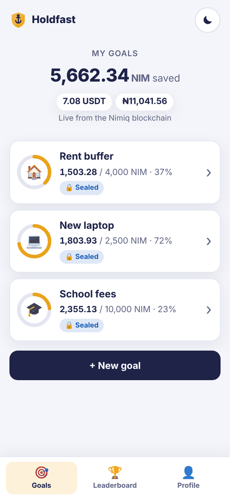
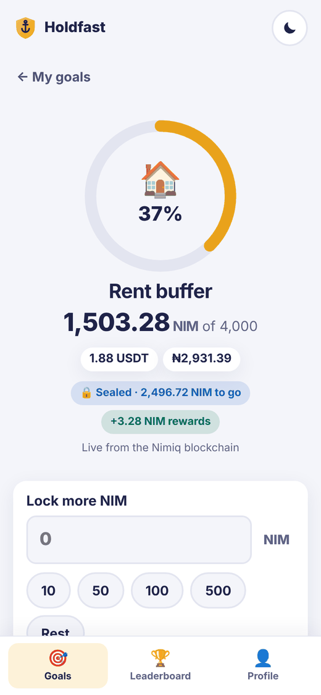
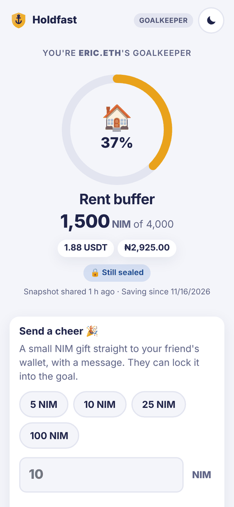
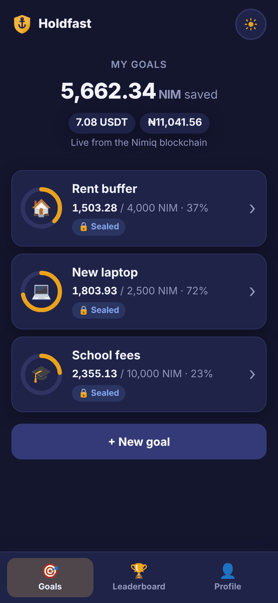
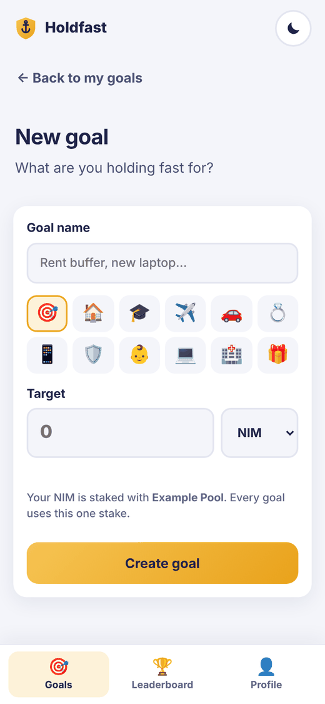
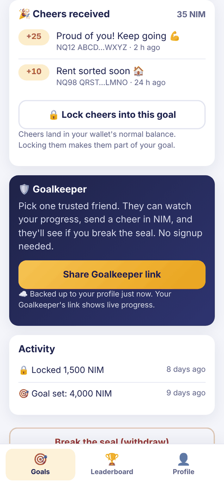
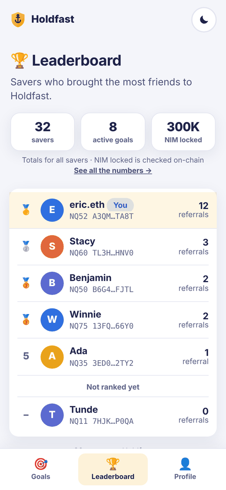
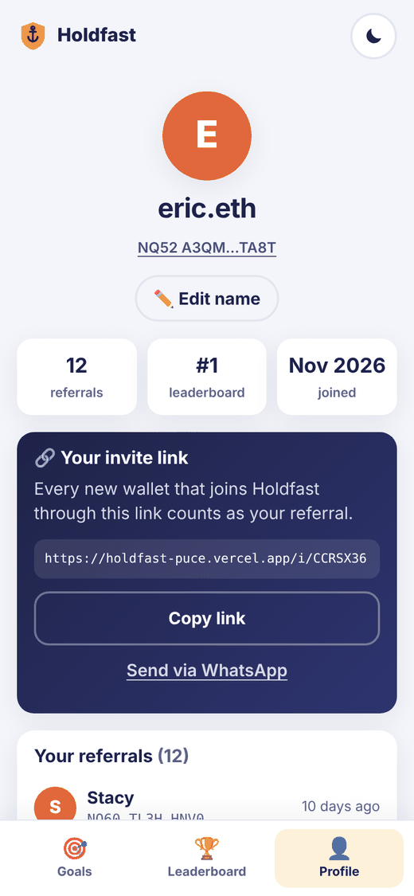
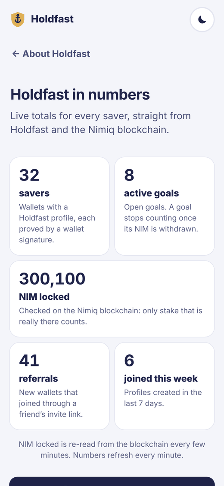

# Holdfast Savings

**Save it. Stake it. Hold fast.**

Savings goals inside the **Nimiq Pay** wallet. Saving into a goal **stakes NIM from your own wallet**: it earns rewards, stays yours, and takes a deliberate 12-to-24-hour withdrawal to spend.
One friend, your **Goalkeeper**, watches your progress, cheers you on in NIM and sees it if you break the seal.
Built for the Nimiq Mini Apps Competition, Cycle III (Save category). Version 1.0.0.

**Live:** https://holdfast-puce.vercel.app · **[Open in Nimiq Pay](https://holdfast-puce.vercel.app)** (the page's button opens `nimiqpay://miniapp?url=https://holdfast-puce.vercel.app/`) · **Demo video:** DEMO_VIDEO_URL · **Usage numbers:** [#/stats](https://holdfast-puce.vercel.app/#/stats)

<p>
  
  
  
  
</p>
<p>
  
  
  
  
  
</p>

<sub>Screenshots of the release build with sample goals and prices.</sub>

---

## The problem

- People set savings goals and then dip into them.
- Apps that hold your savings can freeze accounts and charge withdrawal fees.
- Goal trackers only log numbers; no money actually moves.

## The solution

| Feature | What it does |
|---|---|
| 🔒 **Lock it** | Saving into a goal **stakes NIM from your own wallet**. It never leaves your control and earns staking rewards. Getting it back takes Nimiq's unstaking cool-down, which slows down impulse withdrawals. |
| 🎯 **Several goals** | Up to **5 goals at once**, each with its own progress, Goalkeeper link, cheers and withdrawal. |
| 🛡️ **Goalkeeper** | Share a link with one friend. Without signing up they see your **live** progress, send a **cheer** (NIM with a message) and see if you **break the seal**. |
| 🎉 **Cheer wall** | Cheers are read from the blockchain and shown to you and your Goalkeeper. One tap locks them into your goal. |
| 💵 **Dollar view** | Every amount in **NIM, USDT and naira**. Set a target in whichever you think in. |
| 👤 **Profiles & invites** | Your wallet is your account. A display name, your own invite link, and a public **leaderboard** of referrals. |
| ☁️ **Backup** | With a profile, goals come back on a new phone, and Goalkeeper links stay live. |
| 🌗 **Light & dark** | Follows your phone; the sun/moon button switches and remembers. |

**Holdfast never holds your money or keys.** Every transaction is shown and signed by you in Nimiq Pay. If Holdfast's own server is down, saving, locking and withdrawing still work.

## Built on Nimiq

NIM does more in Holdfast than move from one wallet to another:

- **Staking is the lock.** A goal is real stake in your wallet, made and released with Nimiq's staking transactions: create staker, add stake, deactivate, retire, remove.
- **Confirmed on chain.** Every lock and withdrawal step is checked on the Nimiq blockchain (`getTransactionByHash`, `getStakerByAddress`) before Holdfast counts it. A refused lock is taken off its goal; a withdrawal follows the staker's real balances.
- **Cheers carry on-chain messages.** A cheer is a NIM payment with `Holdfast cheer <goal>: <message>` in its data, read back from the wallet's transaction history.
- **Wallet-signed profiles.** One Nimiq signed message proves a profile belongs to its wallet: no password, no email. The server checks the Ed25519 signature and derives the address from the key.
- **Usage counted on chain.** "NIM locked" on the [stats page](https://holdfast-puce.vercel.app/#/stats) counts only stake the blockchain confirms.

---

## How it works

### For savers
1. **Create a goal:** a name, an icon and a target (NIM, USDT or naira). Your first goal picks a validator; later goals share the same stake.
2. **Lock NIM:** type an amount or tap 10 / 50 / 100 / 500 / Rest. Nimiq Pay asks you to approve. Holdfast confirms the transaction on chain: "Locked 50 NIM. Hold fast! 🔒".
3. **Watch it grow:** the ring shows progress; rewards are added as they are earned.
4. **Share with a Goalkeeper** by any app, WhatsApp or a copied link.
5. **Reach the goal:** Holdfast celebrates. The NIM stays staked until you decide otherwise.

First-time users see three short cards (Lock it · Goalkeeper · Hold fast), once, skippable.

### Breaking the seal (withdrawing)
Possible at any time, but slow on purpose:
1. **Type the goal's name** to confirm (or tap "Keep holding fast").
2. **Deactivate:** your Goalkeeper sees that you're withdrawing.
3. **Retire**, once the network's cool-down is over. Holdfast shows a countdown ("ready in about 13 h") and keeps the button disabled until then. The deactivation takes effect at the next election block (up to 12 hours), then the stake stays locked one more epoch (43,200 blocks, about 12 hours).
4. **Return** the NIM to your wallet.

Each step counts only once the network confirms it. A goal whose NIM has all come back shows **↩️ Withdrawn** and leaves the public numbers.

### How several goals share one stake
A Nimiq wallet has one stake with one validator. Goals divide it:
- **Wallet baseline:** stake that belongs to no goal (what you had before Holdfast, plus closed goals). Read from the chain once nothing changed for 3 minutes.
- **Each goal's share:** stake above the baseline is split between active goals in proportion to what each holds (locked plus rewards already earned), so a new goal never takes old rewards.
- **Withdrawing from one goal** can take at most that goal's share. **Closing a goal** moves its NIM to the baseline.

### For Goalkeepers (the friend)
Open the link: no install, no account. See the goal, live progress in NIM, USDT and naira, the cheer wall, and whether it's 🔒 sealed, 🎉 reached or ⚠️ broken. The page reads the saver's stake from the blockchain, so a withdrawal shows even if made outside Holdfast. **Send a cheer:** in Nimiq Pay it sends directly; elsewhere it opens a Nimiq payment link.

### Profiles, invites and the leaderboard
1. **Create a profile** by signing one message in Nimiq Pay. Free, moves no NIM.
2. **Invite link:** `https://holdfast-puce.vercel.app/i/ABC2345`. A new wallet that creates its profile through it counts as your referral (once, for one inviter, never yourself).
3. **Invites survive the jump into Nimiq Pay** three ways: a same-network match within 30 minutes, an invite-code field, and "Who invited you?" on the Profile screen during the first week.
4. **Leaderboard:** most referrals first; equal counts share a rank, earliest joiner first. Anyone can view it.

### Opening Holdfast
- **In Nimiq Pay** it connects by itself. If the wallet declines or doesn't answer, a **Connect Nimiq Pay** button retries.
- **In a browser** it shows the landing page, with an **Open in Nimiq Pay** button. If nothing happens, it shows the address to paste under *Mini Apps → Custom URL*.

---

## Privacy: what Holdfast stores

On your phone: your goals (per wallet address), the theme, and whether you've seen the intro.

On Holdfast's server (Upstash Redis), only with a profile:

| Stored | Why |
|---|---|
| Wallet address, public key, display name | The profile itself |
| The signed message and signature | Proof that the wallet's owner created the profile |
| Nimiq Pay device identifier | An anonymous phone ID; Nimiq Pay asks first, empty if declined |
| Browser ID (cookie + localStorage) | A random ID, to notice many wallets from one browser |
| Joined and last-seen times, country | Country from the host's location header; the IP itself is not stored |
| Inviter, how the invite was matched, your referrals | The leaderboard |
| A scrambled note of the network that opened an invite link | 30 minutes only, so the invite survives the jump into Nimiq Pay |
| Goal backup: goals, targets, amounts, recent activity, your Nimiq Pay addresses | Restore on a new phone; live Goalkeeper pages (a friend sees one goal, never your other goals' names) |
| Each saver's goal total confirmed on chain | The public "NIM locked" number |

Without a profile: nothing about you. **Error reports** (the last 300 app errors) keep only the message, the screen, the app version and the time: never a wallet address or IP. Rate-limit counters use a hashed IP and expire within minutes.

Set `HF_REQUIRE_UNIQUE_DEVICE=1` to stop counting referrals from a device or browser already seen.

---

## What's built and tested

| Area | Status |
|---|---|
| Goal creation, several goals, locking, the full 3-step withdrawal, Goalkeeper sharing, cheers, theme switch | ✅ Tested on a real phone in Nimiq Pay |
| Wallet connection screens (approved, declined, no answer, retry) | ✅ Tested on a real phone in Nimiq Pay |
| **Open in Nimiq Pay** button | ✅ Tested on a real phone in Nimiq Pay |
| Profiles, sign-in with a wallet signature, invite links, referrals, leaderboard | ✅ Tested on a real phone in Nimiq Pay, with real Nimiq Pay signatures |
| Real staking transactions inside Nimiq Pay, confirmed on chain | ✅ Tested on a real phone in Nimiq Pay |
| Live progress straight from the blockchain | ✅ Tested on a real phone in Nimiq Pay, through Holdfast's own read-only relay |
| Goal backup and restore, live Goalkeeper pages, cheer wall, usage numbers | ✅ Tested on a real phone in Nimiq Pay |
| Amount parsing, address checks, goals and stake shares, withdrawals, share links, sign-in, referral, stats, error-report and security-header rules | ✅ 100 automated tests (`npm test`) |

The full checklist, with the release smoke test, is in [docs/QA.md](docs/QA.md). Changes are listed in [CHANGELOG.md](CHANGELOG.md).

---

## Run it yourself

Needs [Node.js](https://nodejs.org) 20 or newer.

```bash
git clone https://github.com/Eric-65/Holdfast.git
cd Holdfast
npm install
npm run dev
```

| Command | What it does |
|---|---|
| `npm run dev` | Starts the app and a local API (in-memory database) |
| `npm test` | Runs the automated tests |
| `npm run build` | Builds the app into `dist/` |
| `npm run preview` | Serves the built app locally |

**Try it in Nimiq Pay:** run `npm run dev` and open your computer's local network address (printed in the terminal) under *Mini Apps → Custom URL*.

### Settings

App settings (optional, in `.env`; copy `.env.example`):

| Setting | Purpose |
|---|---|
| `VITE_NIMIQ_RPC_URL` | **Leave unset.** The phone then reads the chain through Holdfast's relay; most public RPC servers refuse requests from web pages. `/api/hf?a=health` shows `directRpcFromPhone: false`. |
| `VITE_VALIDATORS_API_URL`, `VITE_PRICE_API_URL` | Validator list and NIM prices (CoinGecko format). If you change these hosts, add them to `connect-src` in `vercel.json`'s Content-Security-Policy. |
| `VITE_API_BASE` | Where the Holdfast API lives, if not on the same site |

Server settings (on the host):

| Setting | Purpose |
|---|---|
| `KV_REST_API_URL`, `KV_REST_API_TOKEN` | The Upstash Redis database (Vercel sets these when you connect it). `UPSTASH_REDIS_REST_*` work too. |
| `HF_ADMIN_TOKEN` | A long random secret (16+ characters). Unlocks `/api/hf?a=report&token=…` (recent app errors) and the backup part of `?a=health&addr=…&token=…`. |
| `NIMIQ_RPC_URL`, `NIMIQ_TESTNET_RPC_URL` | RPC servers the relay reads from. Defaults: `https://rpc.nimiqwatch.com` and `https://rpc.testnet.nimiqwatch.com`. |
| `HF_REQUIRE_UNIQUE_DEVICE` | `1`: count a referral only from a new device and browser |

### Deploy

Vercel builds every push; `main` is production at https://holdfast-puce.vercel.app. Profiles need a database: **Storage → Create Database → Upstash → Redis**, connect it, redeploy. Without it, goals, locking and Goalkeeper links still work and the profile screens stay hidden. The GitHub workflow runs the tests and the build on every push.

**Check a deployment:** `/api/hf?a=health` answers with `version` (the commit), `appVersion`, the relay status and the latest block. A running app checks `?a=version` and offers "Update available — tap to reload" when a newer build is live.

---

## Under the hood

- **Tech:** Vite + TypeScript, no UI framework, about 37 kB of gzipped JavaScript. One serverless API function (`api/hf.ts`).
- **Wallet:** [`@nimiq/mini-app-sdk`](https://www.npmjs.com/package/@nimiq/mini-app-sdk). Before a lock Holdfast reads whether the wallet is a staker and picks *create staker* or *add stake*; on testnet the validator comes from the testnet itself.
- **Blockchain reads** go through Holdfast's own relay (`/api/hf?a=rpc`), which forwards only four read methods (`getBlockNumber`, `getStakerByAddress`, `getTransactionByHash`, `getActiveValidators`), checks every parameter, times out after 8 s and lets the CDN cache answers. The phone retries every 30 seconds while a goal is open and says "Network busy, showing your Holdfast records" until then.
- **Safe withdrawals:** deactivating sets the wallet's *total* active stake, so Holdfast reads the live stake right before signing and sends `live − amount`, capped at the goal's share. If the read fails, nothing is sent.
- **Readings after a transaction:** for 3 minutes, a reading that doesn't show the change yet is ignored.
- **Reliability:** every request has a timeout and a retry; buttons that wait show a spinner and can't be pressed twice, even across a redraw. Uncaught errors are reported (no addresses, no IP) so problems people hit are visible.
- **Security:** a strict Content-Security-Policy (scripts from the site only, plus the one inline theme script by hash), `nosniff`, a referrer policy, and camera, microphone and location turned off. Every API action checks its input and is rate-limited by hashed IP or wallet. `npm audit --omit=dev` is clean.
- **Goalkeeper links** keep the goal in the part after `#`, which browsers never send to a server.

```
src/
  main.ts        start-up and routing          app.ts      shared state, chain reads
  account.ts     profiles, invites, backup     ui.ts       html, sheets, rings, busy buttons
  lib/           wallet, chain, prices, goals (store.ts), share links, error reports
  views/         landing, goals, Goalkeeper, profile, leaderboard, stats, intro
api/
  hf.ts          the API            _lib/   sign-in and referrals (core.ts), relay and cheers (chain.ts),
                                            goal backup and stats (goals.ts), error reports (report.ts)
tests/           automated tests    docs/   screenshots, QA checklist, promotion kit
```

## Known limits

- Up to **5 active goals** per wallet; they share one stake and one validator.
- Rewards are divided by Holdfast's rule above, not by the chain.
- Cheers arrive in the normal balance; the saver can lock them into the goal.
- Without a profile, a Goalkeeper link shows a snapshot from when it was shared.
- The cheer wall needs the RPC server to keep transaction history.
- If the RPC server doesn't answer, goals show Holdfast's records and withdrawals wait until it answers.
- Nimiq Pay sends one transaction at a time per wallet; a transaction it still shows as pending blocks the next one until it resolves or expires.
- One person with several wallets can make several profiles; device and browser IDs make this visible.

## License

MIT. The landing-page photos in `public/photos/` come from [Pixabay](https://pixabay.com) under the [Pixabay Content License](https://pixabay.com/service/license-summary/) and are not covered by the MIT license.
