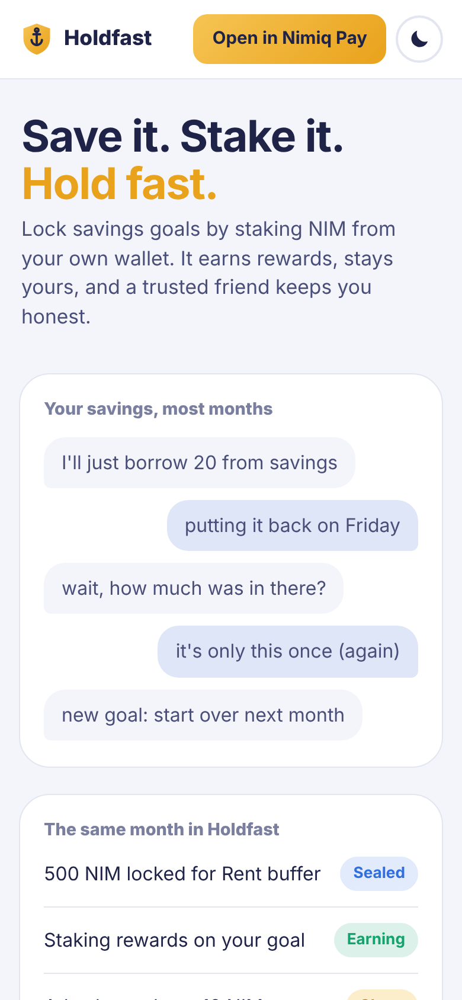
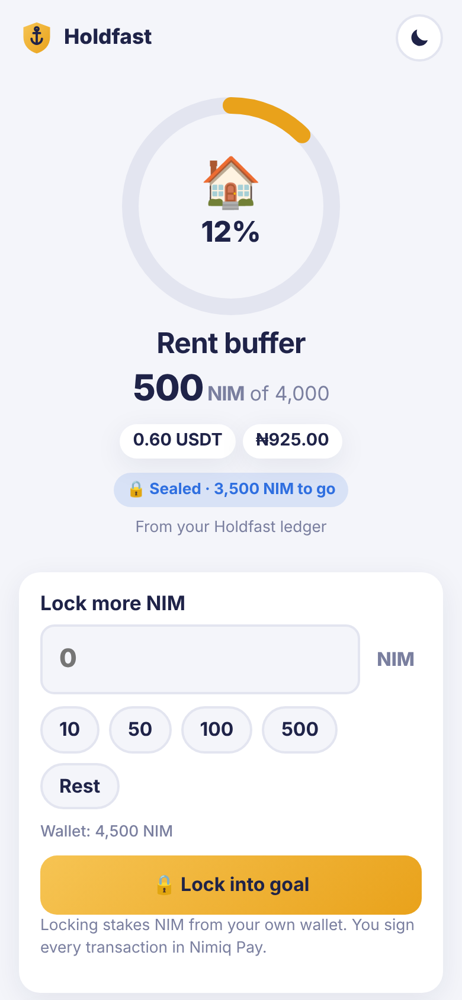
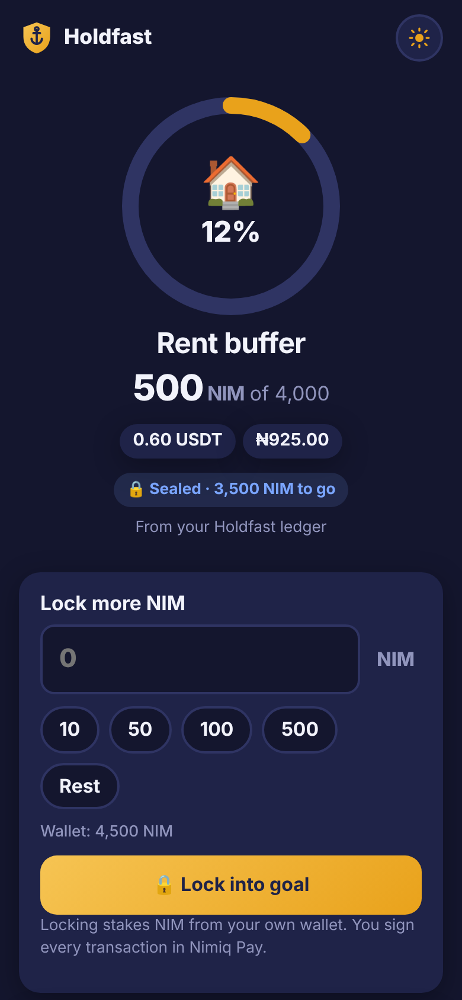
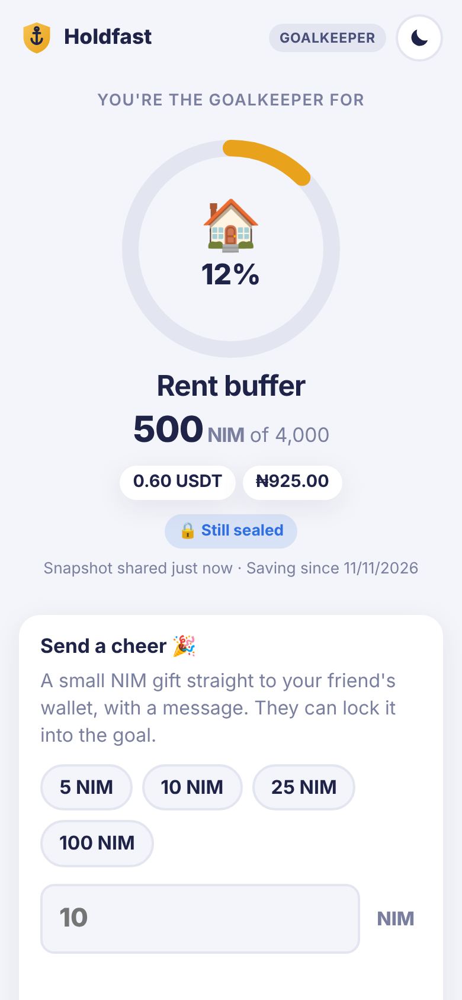

# Holdfast

**Save it. Stake it. Hold fast.**

Holdfast is a savings app that runs inside the **Nimiq Pay** wallet. When you save toward a goal, your NIM is staked: it stays in your own wallet, earns rewards and is harder to spend on impulse. A friend you trust keeps you on track.

Built for the Nimiq Mini Apps Competition, Cycle III (Save category).

<p>
  
  
  
  
</p>

<sub>Screenshots use sample prices.</sub>

---

## The problem

- People set savings goals and then dip into them.
- Savings apps that hold your money can freeze accounts, fail logins and charge withdrawal fees.
- Goal-tracker apps only log numbers. No money actually moves.

## The solution

| Feature | What it does |
|---|---|
| 🔒 **Lock it** | Saving into a goal **stakes NIM from your own wallet**. Your money never leaves your control and it earns staking rewards. Getting it back takes Nimiq's unstaking cool-down, which slows down impulse withdrawals. |
| 🛡️ **Goalkeeper** | You share a link with one trusted friend. Without signing up, they can see your progress, send you a **cheer** (a NIM gift with a message) and see if you **break the seal** (start withdrawing). |
| 💵 **Dollar view** | Every amount shows in **NIM, USDT and NGN**. You can also set your target in USDT or naira. |
| 🌗 **Light & dark theme** | Follows your phone's setting. Tap the sun/moon button to switch, and Holdfast remembers your choice. |

**Holdfast never holds your money.** Every transaction is shown and signed by you in Nimiq Pay.

---

## How it works

### For savers
1. **Create a goal.** Give it a name, an icon and a target (in NIM, USDT or NGN), and pick a validator. A validator is the network node your stake is delegated to.
2. **Lock NIM.** Enter an amount or tap a shortcut (10, 50, 100, 500, or "Rest" for whatever is left to reach the target). Nimiq Pay asks you to approve the staking transaction.
3. **Watch it grow.** A progress ring shows how close you are, in NIM, USDT and naira.
4. **Share with a Goalkeeper.** Tap *Share Goalkeeper link* and send it by any app, by WhatsApp or by copying it.
5. **Reach the goal.** Holdfast celebrates and you can start a new one. Your NIM stays staked until you decide otherwise.

### Breaking the seal (withdrawing)
Withdrawing is possible but deliberately slow:
1. You must **type the goal's name** to confirm. You can also tap "Keep holding fast" instead.
2. **Deactivate** the stake. Your Goalkeeper can now see that you're withdrawing.
3. After Nimiq's cool-down period, **retire** the stake.
4. **Return** the NIM to your wallet.

Holdfast shows each step and tells you what to do next.

### For Goalkeepers (the friend)
- Open the link. No app install or account is needed.
- See the goal, progress, amounts in USDT and naira, and whether it is 🔒 sealed, 🎉 reached or ⚠️ broken.
- **Send a cheer:** pick an amount and write a short message. Inside Nimiq Pay it sends directly. Elsewhere it opens a Nimiq payment link.

### Opening Holdfast
- **In Nimiq Pay:** Holdfast connects to your wallet by itself. Nimiq Pay may ask you to approve sharing your wallet address. If the wallet doesn't answer or you decline, Holdfast shows a **Connect Nimiq Pay** button to try again.
- **In a normal browser:** Holdfast tells you that you're outside Nimiq Pay and shows an **Open in Nimiq Pay** button. On a phone with Nimiq Pay installed, it opens the app there directly. If nothing happens, Holdfast shows the address to paste into Nimiq Pay under *Mini Apps → Custom URL*.

---

## What's built and tested

| Area | Status |
|---|---|
| Goal creation, locking, the full 3-step withdrawal, Goalkeeper sharing, cheers, theme switch | ✅ Built. Tested end to end in a mobile browser with a simulated Nimiq Pay wallet |
| Wallet connection screens (approved, declined, no answer, retry) | ✅ Tested in a browser with a simulated Nimiq Pay wallet |
| **Open in Nimiq Pay** button | ⚠️ Built from the documented link format. Needs a check on a phone with Nimiq Pay installed |
| Amount parsing, Nimiq address checks, goal history, share links, API data parsing | ✅ 19 automated tests |
| Real staking transactions inside Nimiq Pay | ⚠️ Built with the official Nimiq SDK. Needs a final check on a real device |
| Live progress straight from the blockchain | ⚙️ Works when an RPC address is set (see [Settings](#settings)). Otherwise it uses Holdfast's own records |

---

## Run it yourself

You need [Node.js](https://nodejs.org) 20 or newer.

```bash
git clone https://github.com/Eric-65/Holdfast.git
cd Holdfast
npm install
npm run dev
```

Open the address it prints (usually http://localhost:5173). In a normal browser you'll see the landing page; saving and locking need Nimiq Pay (see below).

| Command | What it does |
|---|---|
| `npm run dev` | Starts the app locally |
| `npm test` | Runs the automated tests |
| `npm run build` | Builds the finished app into `dist/` |
| `npm run preview` | Serves the built app locally |

**Try it in Nimiq Pay:** run `npm run dev`, then open your computer's local network address (it is printed in the terminal) as a Mini App in Nimiq Pay.

### Settings

All settings are optional. To use them, copy `.env.example` to `.env`.

| Setting | Purpose |
|---|---|
| `VITE_NIMIQ_RPC_URL` | A Nimiq RPC server that allows browser requests. It turns on **live** blockchain progress (including staking rewards) and live withdrawal alerts for Goalkeepers. Without it, Goalkeepers see the snapshot saved in their link. |
| `VITE_VALIDATORS_API_URL` | Where to load the validator list from |
| `VITE_PRICE_API_URL` | Where to load NIM prices from (CoinGecko format) |

### Deploy

The built app is a plain static website, so any static host works. The included GitHub Actions workflow runs the tests on every push. On `main`, if they pass, it publishes the app to GitHub Pages, so a broken build never goes live. To turn it on, go to **Settings → Pages → Source: GitHub Actions**.

---

## Under the hood

- **Tech:** Vite and TypeScript, with no UI framework (about 17 kB of JavaScript, gzipped).
- **Wallet:** [`@nimiq/mini-app-sdk`](https://www.npmjs.com/package/@nimiq/mini-app-sdk). The first lock creates a staker, later locks add to it, and withdrawals use the deactivate, retire and remove steps.
- **Storage:** your goals are saved on your device, separately for each wallet address.
- **Goalkeeper link:** the goal details sit in the part of the link after `#`, which browsers never send to a server.
- **Open in Nimiq Pay:** the button uses Nimiq Pay's `nimiqpay://miniapp?url=…` link.
- **Prices:** NIM prices from CoinGecko, converted to USDT with the live USDT rate, refreshed every 5 minutes. If it can't be reached, Holdfast shows the last known price.

```
src/
  main.ts        app start-up and page routing
  app.ts         shared app state
  lib/           wallet, blockchain, prices, goals, share links, theme
  views/         saver screens and the Goalkeeper page
  style.css      all styles, including light and dark themes
tests/           automated tests
```

## Known limits

- Nimiq counts all of a wallet's stake together, so Holdfast runs **one goal at a time**. Stake you already had before creating a goal doesn't count toward it.
- Cheers arrive in the saver's normal balance. The saver can then lock them into the goal.
- Without an RPC address, Goalkeepers see progress as of when the link was shared. Re-share it to update.

## License

MIT
